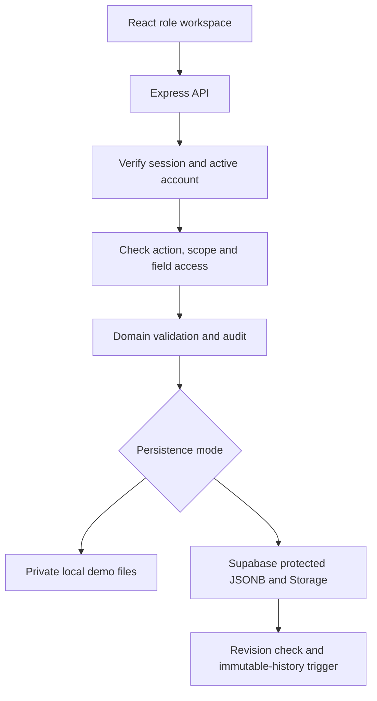

# Design and boundaries

## Existing foundation

The supplied project contains React/Vite, Express, Supabase Auth integration, relational campuses/departments/profiles/roles/role_assignments, and migrations 001–003. An additional 004 department SQL file exists, but execution was uncertain. The original App imported DepartmentList without rendering it. Environment files and Windows node_modules were excluded from the handoff.

## Current implementation

React obtains the runtime mode from Express. Demo accounts receive opaque eight-hour bearer tokens stored in browser sessionStorage; the backend checks the account on every request. Supabase mode verifies the bearer token using Auth getUser, reads the current profile and scoped role assignments under user RLS, and then applies domain authorization.

The complete operational workspace is persisted as JSONB in a service-only Supabase table, or as an atomically replaced local file for demo mode. This is a deliberate deadline-driven prototype choice, not a claim of normalized production storage. Student IDs, campus IDs, department IDs and entity references still connect the domain records. Writes are serialized locally; Supabase writes use optimistic revision checks across processes. Stale writes return a conflict rather than losing a concurrent update.

Normal clients have no access to the operational workspace table or save RPC. The elevated backend client is used only after authentication and authorization. Field filtering happens before responses leave Express. Document blobs are private and served only after checking the student's relationship/scope. No static document folder is exposed.

## Major flows

1. Admission → pending identity → document review → confirmation → charge under the current campus fee rule.
2. Payment → balance and reference checks → charge allocations → immutable receipt.
3. Reversal request → different authorized approver → linked negative payment; original unchanged.
4. Attendance session → scoped marking → locking → reviewed corrections.
5. Bed allocation → student/bed conflict checks → dated allocation and hostel charge → check-out preserves history.
6. Transfer request → trust approval → unchanged student identity; old financial records remain tied to their original campus.
7. Import → validation → exact or manually reviewed identity link → source resolution log; repeat fingerprints blocked.
8. Staff appointment → explicit portal provisioning → teaching assignment → transfer/separation preserves history and restricts access.

## Production work remaining

Normalize the operational workspace into dedicated relational tables and transactional procedures. Add database-level invariant constraints for all modules, indexes, partitioning and paging for large datasets. Implement audit hardening beyond ordinary admin privileges, automated backups/restores, institution-specific retention and consent rules, malware scanning, secure password recovery/invitations, MFA for privileged users, and live deployment security. Complete multi-appointment/multi-child administration, arbitrary approval delegations and campus-to-campus acknowledgement workflows. Load-test the 14,000-student target; no such test has been performed.

The current implementation supports multiple authorization assignments from Supabase, but the account-management UI is intentionally narrower: trusted CLI provisioning handles new grants, and the sample guardian links one child. Avoid claiming a finished enterprise ERP.

## Request and storage flow

